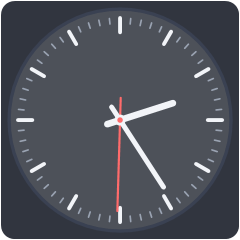
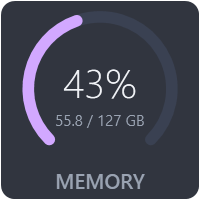
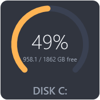

# Desktop Widgets

Always-behind desktop widgets for Windows 10/11: a resizable clock (digital or analog),
date, CPU usage, GPU usage and memory usage. Widgets live on the desktop itself —
above the wallpaper, **below every application window** — and never steal focus.

Project home: <https://github.com/simonsoanes/DesktopWidgets>







## Using it

Run `publish\DesktopWidgets.exe` (or `dotnet run`). A clock-face icon appears in the
notification area; that tray menu is the app's only chrome.

- **Add widget** — Clock (digital), Clock (analog), Date, CPU usage, GPU usage, Memory usage,
  Disk space (any fixed/removable drive).
- **Move** — drag with the left mouse button. Widgets magnetically snap to each other's
  edges, centres and docks (8 px gap) and to screen edges (10 px threshold).
- **Resize** — drag the grip in the widget's bottom-right corner (appears on hover).
  Everything is vector-drawn, so it stays crisp at any size.
- **Never lost** — a widget that ends up off every monitor (unplugged display, resolution
  change) is pulled back to the nearest one on drag-end, on display changes and at startup;
  tray → *Gather widgets on primary screen* rescues them all. Second-monitor widgets stay put.
- **Right-click a widget** — switch a clock between Analog/Digital, pick the drive for a
  Disk widget, set opacity (presets 100–25 % or a custom slider), reset its size, or close it.
- **Start with Windows** — tray menu toggle (per-user `Run` registry key).
- **About** — tray menu → About Desktop Widgets: version, copyright and the full
  Apache-2.0 licence text (embedded, readable offline).
- **Exit** — tray menu. Layout, sizes, modes and opacity are saved automatically.

First run seeds one of each widget in a row near the top of the primary screen;
close or rearrange anything you don't want — the layout persists.

### Always-behind behaviour

Each widget window forces itself to `HWND_BOTTOM` on every `WM_WINDOWPOSCHANGING`,
and carries `WS_EX_NOACTIVATE | WS_EX_TOOLWINDOW`: clicking or dragging a widget never
focuses it or pulls it above your work, and it stays out of Alt-Tab and the taskbar.
`SC_MINIMIZE` is swallowed (plus a minimise-state guard) so **Win+D / Win+M leave the
widgets on the desktop**. Verified live: widgets sit directly above `Program Manager`
and below all application windows in the Z-order.

## Widgets and data sources

| Widget | Shows | Source |
|---|---|---|
| Clock | `HH:mm:ss`, or analog face with sweeping second hand | system time |
| Date | weekday + full date, current culture | system time |
| CPU | total utilisation % | `GetSystemTimes` (idle/kernel/user deltas) |
| GPU | busiest engine utilisation % | `GPU Engine` PDH wildcard query, one collect per sample (WDDM 2.x); `N/A` where unavailable |
| Memory | used % + `used / total GB` | `GlobalMemoryStatusEx` |
| Disk | used % + `free / total GB free`, per drive | `DriveInfo` (fixed/removable, every 5 s) |

Stats are sampled once per second on a background thread and shared by all widgets;
analog clocks additionally redraw at ~30 fps for a smooth sweep.

## Settings

`%APPDATA%\DesktopWidgets\settings.json` — widget list with kind, clock mode, position,
size and opacity, plus the start-with-Windows flag. Corrupt or missing files fall back
to defaults; positions are clamped to a connected monitor on restore, and the layout
survives reboots - closing a widget from its menu is the only thing that removes it.

## Build

Requires the .NET 10 SDK and, to run, the **.NET 10 Desktop Runtime** (framework-dependent
by design — the published app is a single ~220 KB exe instead of a ~100 MB self-contained bundle).

```powershell
dotnet build -c Release
dotnet publish -c Release -r win-x64 --self-contained false -p:PublishSingleFile=true -o publish
```

### Releases

Pushing a tag matching `v*` (e.g. `v1.0.1`) runs `.github/workflows/release.yml` on a
Windows runner: it publishes the single-file exe stamped with the tag's version, zips
it together with `LICENSE`, `NOTICE` and `README.md`, and attaches
`DesktopWidgets-<tag>-win-x64.zip` to a GitHub Release with generated notes. Re-running
a tag uploads the zip again (`--clobber`) instead of failing.

Offscreen verification mode (renders every widget to PNG and writes live stats, no windows shown):

```powershell
.\publish\DesktopWidgets.exe --preview preview
```

## License

Copyright 2026 Simon Soanes.

Licensed under the Apache License, Version 2.0 (the "License"); you may not use this
project except in compliance with the License. You may obtain a copy of the License at
<http://www.apache.org/licenses/LICENSE-2.0>. See [LICENSE](LICENSE) for the full text
and [NOTICE](NOTICE) for attribution. Source and releases:
<https://github.com/simonsoanes/DesktopWidgets>.

## Architecture

One WPF project, no third-party packages:

- `WidgetCanvas.cs` — all widget rendering in a single `OnRender` element (vector text,
  clock face/hands, 270° gauges); resolution-independent.
- `WidgetWindow.cs` — transparent borderless host: always-behind interop, drag, grip
  resize, right-click menu; `WidgetChrome` draws the shared translucent card.
- `SystemStats.cs` — demand-driven sampling: only metrics some live widget displays are
  sampled at all (a clock-only layout does none); GPU uses a single PDH wildcard collect
  per tick instead of per-instance counters.
- `App.xaml.cs` — single-instance mutex, tray wiring, 1 Hz shared tick, debounced
  settings persistence, first-run layout, `--preview` mode.
- `TrayIcon.cs` — notification-area icon (generated at runtime) and menu.
- `Settings.cs`, `NativeMethods.cs` — JSON persistence and Win32 interop.

## Background

This utility was developed as part of testing for the Ariadne AI platform.